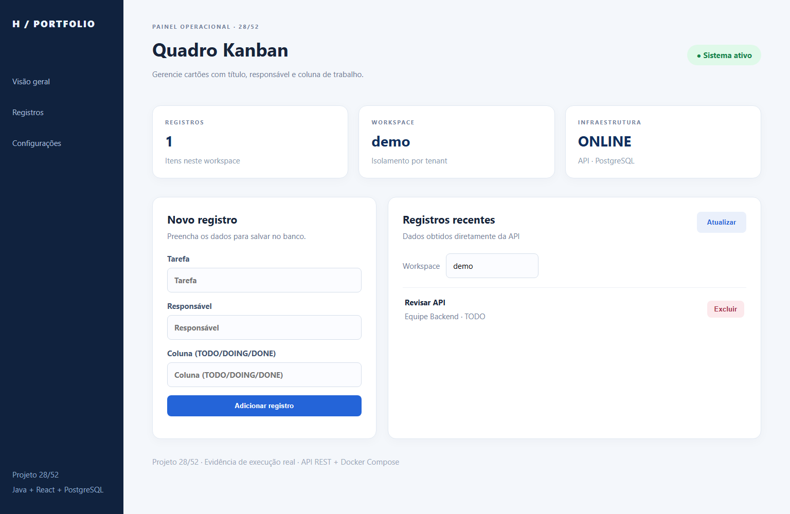

# Quadro Kanban

Projeto 28/52 — Gerencie cartões com título, responsável e coluna de trabalho.

## Stack
Java 25, Spring Boot, PostgreSQL 17, Flyway, React 19, esbuild, Docker Compose, Playwright.

## API
- `GET /api/health` — saúde da API
- `GET /api/entries` — listar registros
- `POST /api/entries` — criar registro (`title, assignee, status` obrigatórios)
- `DELETE /api/entries/{id}` — excluir registro

O cabeçalho `X-Tenant` identifica um workspace demonstrativo, **não é autenticação nem isolamento seguro entre usuários**.

## Evidência real

A imagem é criada pelo script de publicação somente após o frontend e a API responderem, com um registro persistido.

## Execução
`docker compose up -d --build`

Frontend: http://localhost:5188 | API: http://localhost:8198/api/health

## Critérios de conclusão do MVP
Build Java e frontend, PostgreSQL saudável, GET/POST/DELETE funcionando, screenshot real versionado, push público e CI concluída com sucesso.
